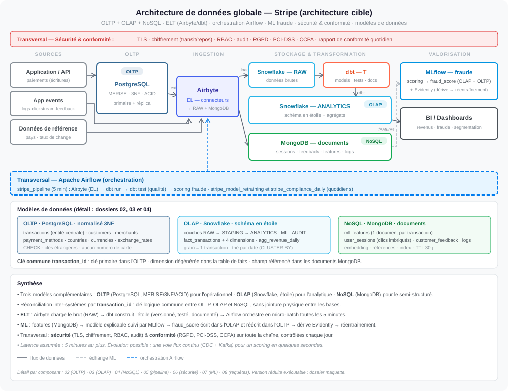

# Livrable 1 : diagramme d'architecture de données complet

**Énoncé :** un diagramme détaillé de l'intégration des systèmes OLTP, OLAP et NoSQL, avec les
flux de données, les pipelines et les modèles de données.

| Fichier | Contenu |
|---|---|
| [`architecture_globale.svg`](architecture_globale.svg) | l'architecture cible sur une page |

---

## Lire le diagramme

**De gauche à droite :**

1. **Sources** : l'application écrit dans l'**OLTP PostgreSQL** et émet des événements (journaux,
   clics, avis) ; les référentiels fournissent pays et taux de change.
2. **Ingestion (EL)** : **Airbyte** charge le brut dans **Snowflake RAW** et dans **MongoDB**.
3. **Transformation (T)** : **dbt** construit le **schéma en étoile** de la couche ANALYTICS et
   ses agrégats, puis le teste.
4. **Valorisation** : le **modèle de fraude** (MLflow) lit ses features dans MongoDB, écrit son
   score dans l'OLAP et le réécrit dans l'OLTP ; **Evidently** surveille la dérive ; la BI
   interroge l'étoile.

**Deux bandes transversales :** **Airflow** orchestre trois DAG (pipeline toutes les 5 minutes,
réentraînement et conformité quotidiens) ; **sécurité et conformité** s'appliquent à toutes les
étapes (TLS, chiffrement, RBAC, audit, RGPD, PCI-DSS, CCPA).

**Bande des modèles de données** : les tables et collections de chaque système, et la clé
`transaction_id` qui les relie.

## Les choix structurants

| Choix | Justification | Détail |
|---|---|---|
| Trois systèmes spécialisés | écrire vite, agréger vite, absorber le semi-structuré sont des optimisations incompatibles | [02](../02_modele_oltp/README.md), [03](../03_modele_olap/README.md), [04](../04_modele_nosql/README.md) |
| Clé commune `transaction_id` | relier les systèmes sans jointure physique | [05 §9](../05_pipeline/README.md) |
| ELT plutôt qu'ETL | charger le brut une fois, transformer et rejouer dans l'entrepôt | [05 §1](../05_pipeline/README.md) |
| Barrière qualité avant le scoring | aucune donnée non validée n'atteint le modèle | [05 §5](../05_pipeline/README.md) |
| Micro-batch 5 minutes | latence suffisante, architecture simple ; flux continu décrit en évolution | [05 §7-8](../05_pipeline/README.md) |
| Sécurité contrôlée chaque jour | la conformité se prouve, elle ne se déclare pas | [06](../06_securite_conformite/README.md) |
| Modèle explicable et réentraîné sur dérive | décision qui touche un client ; la fraude évolue | [07](../07_integration_ml/README.md) |

## Vues complémentaires

| Question | Plan |
|---|---|
| Comment circule la donnée ? | [`00_plan_pipeline_cible.svg`](../05_pipeline/00_plan_pipeline_cible.svg) |
| Où vit chaque table, qui la déplace ? | [`12_flux_donnees_par_couche.svg`](../05_pipeline/12_flux_donnees_par_couche.svg) |
| Comment est-ce déployé et surveillé ? | [`13_deploiement_supervision.svg`](../05_pipeline/13_deploiement_supervision.svg) |
| Que reproduit la maquette ? | [`20_plan_pipeline_cible_et_maquette.svg`](../05_pipeline/20_plan_pipeline_cible_et_maquette.svg) |
