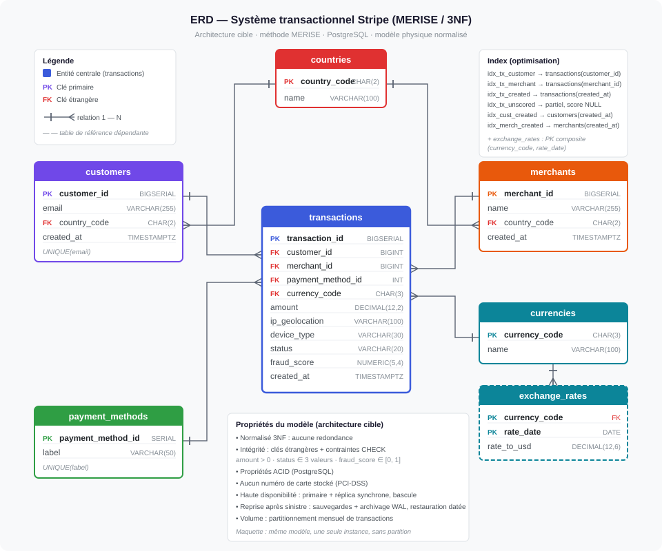

# Livrable 2 : modèle de données OLTP (PostgreSQL)

**Énoncé :** un schéma normalisé pour un traitement transactionnel à haut volume, respectant les
propriétés ACID, avec réplication et basculement en temps réel.

| Fichier | Contenu |
|---|---|
| [`erd_oltp.svg`](erd_oltp.svg) | diagramme entité-relation (patte-d'oie), index, propriétés |
| [`schema_oltp.sql`](schema_oltp.sql) | modèle physique : tables, contraintes, index, référentiels, notes de déploiement |

---

## 1. Rôle

L'OLTP est la **source de vérité opérationnelle** : l'application y écrit chaque transaction au
moment où elle a lieu, en quelques millisecondes, sans jamais enregistrer un paiement incohérent.
Les requêtes lourdes sont déportées vers l'OLAP (livrable 3).

Technologie : **PostgreSQL** — ACID, écosystème de réplication mature, offre managée partout.

## 2. Du besoin au modèle (MERISE)

| Règle de gestion | Conséquence |
|---|---|
| une transaction concerne un seul client | `transactions.customer_id` → `customers` (1-N) |
| une transaction concerne un seul commerçant | `transactions.merchant_id` → `merchants` (1-N) |
| une transaction a un moyen de paiement et une devise | `payment_method_id`, `currency_code` |
| client et commerçant sont rattachés à un pays | `country_code` → `countries` |
| un taux de change existe par devise **et** par date | `exchange_rates`, clé composite |

Champs de l'énoncé couverts : identifiants, montant, devise, moyen de paiement, `created_at`,
`ip_geolocation`, `device_type`, `status`, `fraud_score`.

## 3. Normalisation (3NF)

Valeurs atomiques (1NF) ; la seule clé composite n'a qu'un attribut non clé dépendant des deux
parties (2NF) ; aucun attribut non clé ne dépend d'un autre : pays, devises et moyens de paiement
vivent dans leur propre table (3NF). Le prix, ce sont les jointures — acceptable ici car
l'application lit presque toujours par clé.

## 4. Intégrité et ACID

| Mécanisme | Exemple |
|---|---|
| clés étrangères | pas de transaction sans client existant |
| `CHECK` | `amount > 0` ; `status` ∈ {succeeded, failed, refunded} ; `fraud_score` ∈ [0,1] |
| `UNIQUE` | un email par client |
| `NOT NULL` | client, commerçant, moyen de paiement, devise, montant, statut |

*Atomicité* : un lot est validé entièrement ou pas du tout. *Cohérence* : contraintes vérifiées à
chaque validation. *Isolation* : une transaction en cours n'est visible de personne avant sa validation ; la capture
des changements (CDC) ne publie que des transactions validées, dans leur ordre de validation. *Durabilité* : la transaction
validée est écrite dans le journal des transactions (WAL), puis répliquée (§6).

**Aucun numéro de carte n'est stocké** : la carte reste tokenisée chez le prestataire, ce qui sort
l'OLTP du périmètre le plus exigeant de PCI-DSS (livrable 6).

## 5. Index

| Index | Question servie |
|---|---|
| `idx_tx_customer`, `idx_tx_merchant` | historique d'un client, d'un commerçant |
| `idx_tx_created` | transactions récentes, dans la partition du mois |
| `idx_tx_unscored` (partiel, `WHERE fraud_score IS NULL`) | transactions restées sans score (rattrapage) |
| `idx_cust_created`, `idx_merch_created` | nouveaux clients, nouveaux commerçants |

On n'indexe que les colonnes filtrées en permanence : un index accélère les lectures mais ralentit
chaque écriture. Créés sur la table partitionnée, les index existent automatiquement sur chaque
partition, présente et future.

## 6. Haute disponibilité et reprise

Objectifs (livrable 0 §5) : **99,999 %**, **RPO 0**, **RTO < 30 s**. Détail et matrice des pannes :
[livrable 5 §9](../05_pipeline/README.md).

| Besoin | Dispositif |
|---|---|
| aucune perte de transaction validée | **3 nœuds sur 3 zones**, réplication **synchrone par quorum** (`ANY 1` des 2 réplicas) : un paiement validé existe sur 2 nœuds, et la panne d'un réplica ne bloque rien |
| continuité en cas de panne | **bascule automatique** par **Patroni** (verrou unique dans etcd) ; **HAProxy** donne aux clients une adresse qui suit le primaire |
| capture des changements après bascule | PostgreSQL 17 : slot Debezium en mode *failover*, recopié sur les réplicas ; position de Debezium réalignée sur ce slot après chaque bascule |
| pas de « cerveau divisé » | l'ancien primaire est isolé (lecture seule), puis reconstruit en réplica |
| lectures sans charger le primaire | réplicas asynchrones pour les lectures opérationnelles ; la capture des changements lit le journal, sans requête sur les tables |
| reprise après sinistre | sauvegarde quotidienne et archivage continu du journal des transactions (WAL), ce qui permet de restaurer la base à un instant précis ; copie chiffrée hors région |

## 7. Volume et montée en charge

Les chiffres viennent du [livrable 0](../00_cahier_des_charges/README.md) : **≈ 19 Go par jour**,
**≈ 7,5 To** gardés à chaud (13 mois), **5 000 tx/s** de capacité de conception, **+34 % par an**.

### 7.1 Partitionnement mensuel, dès le départ

`transactions` est **partitionnée par mois sur `created_at`** dès la création de la base
([`schema_oltp.sql`](schema_oltp.sql)) :

| Effet | Pourquoi c'est utile à ce volume |
|---|---|
| **élagage des partitions** : une requête sur un mois ne lit que ce mois | les requêtes opérationnelles portent presque toujours sur les jours récents ; la table entière ne grossit pas pour elles |
| **index par partition** | chaque index reste petit, donc rapide à lire et à mettre à jour |
| **archivage sans blocage** : un mois de plus de 13 mois se détache (`DETACH PARTITION … CONCURRENTLY`), s'exporte et se supprime | la base chaude reste à ≈ 7,5 To au lieu de grossir de 7 To par an ; l'historique complet vit dans Snowflake |
| **partitions créées à l'avance** : `ensure_monthly_partitions(3)`, appelée chaque heure | aucune insertion n'attend la création d'une partition ; une partition par défaut, surveillée, reçoit ce qui dépasserait |

Contrainte : la clé primaire contient la clé de partition, `(transaction_id, created_at)`.
`transaction_id` reste unique en pratique, car il vient d'une séquence.

### 7.2 Répartition sur plusieurs serveurs (sharding), déclenchée par la mesure

Un primaire PostgreSQL tient la capacité de 5 000 tx/s pendant environ deux ans. La surveillance
de capacité compare chaque heure le débit de pointe à cette capacité (livrable 5 §8.3) ; **à 70 %**,
vers 13 mois, on active la répartition horizontale avec **Citus** (PostgreSQL distribué : même
SQL, même Debezium) :

| Table | Répartition | Pourquoi |
|---|---|---|
| `transactions` | par **`merchant_id`**, sur le même serveur que son commerçant | l'historique d'un commerçant reste sur un seul serveur ; la charge se répartit sur des millions de commerçants |
| `merchants` | par `merchant_id` | placé avec ses transactions |
| `customers` | par `customer_id` | un client paie chez de nombreux commerçants : il ne peut pas suivre chacun |
| `countries`, `currencies`, `exchange_rates`, `payment_methods` | **copiées sur chaque serveur** (tables de référence) | petites, lues partout |

**Ce que ça change, assumé :** la clé primaire devient `(merchant_id, transaction_id, created_at)` ;
la clé étrangère vers `customers` ne peut plus être vérifiée par la base (deux répartitions
différentes) et passe sous la responsabilité de l'API et d'un contrôle quotidien ;
`transaction_id` est généré **sans séquence centrale** (identifiant 64 bits horodaté), et reste
un `BIGINT` pour RAW, l'étoile et MongoDB.

**Scénario ×10** (25 000 tx/s, ≈ 70 To par an) : 8 à 16 serveurs Citus, chacun avec son réplica
synchrone ; le partitionnement mensuel continue à l'intérieur de chaque serveur.

## 8. Intégration OLAP et NoSQL

| Point | Choix |
|---|---|
| clé de réconciliation | `transaction_id` : clé primaire ici, dimension dégénérée dans l'étoile, champ référencé dans MongoDB |
| capture des changements | Debezium lit le journal (WAL) et publie chaque transaction validée dans Kafka ; la publication est faite au nom de la table `transactions`, quelle que soit la partition (livrable 5 §6) |
| registre en ajout seul | une transaction n'est jamais modifiée, sauf `fraud_score` quand il est complété par le rattrapage ; un remboursement est une nouvelle ligne |
| minimisation RGPD | la publication ne contient pas `customers.email` ; le rôle `cdc_reader` ne peut pas le lire |
| score | écrit avec la transaction au moment du paiement ; le rattrapage ne complète que les scores manquants (livrable 7) |
| évolution du modèle | une colonne ajoutée à `transactions` est publiée automatiquement ; sur `customers`, seulement si on l'ajoute à la liste des colonnes publiées (protection par défaut) |

## 9. Dans la maquette

La maquette exécute **exactement ce modèle**, partitionnement compris
([`maquette/init/oltp/01-schema.sql`](../maquette/init/oltp/01-schema.sql)), sur
PostgreSQL 17, **en cluster de deux nœuds** (primaire + réplica synchrone, bascule automatique testée :
livrable 5 §9.7). Démonstrations : [`queries/07_partitionnement.sql`](../maquette/queries/07_partitionnement.sql)
(une requête sur octobre 2026 ne lit que la partition d'octobre) et
[`queries/06_evolution_schema.sh`](../maquette/queries/06_evolution_schema.sh) (ajout de colonne à
chaud). Les 3 zones, Patroni, les sauvegardes et le sharding ne sont pas reproduits (plusieurs serveurs
nécessaires).
