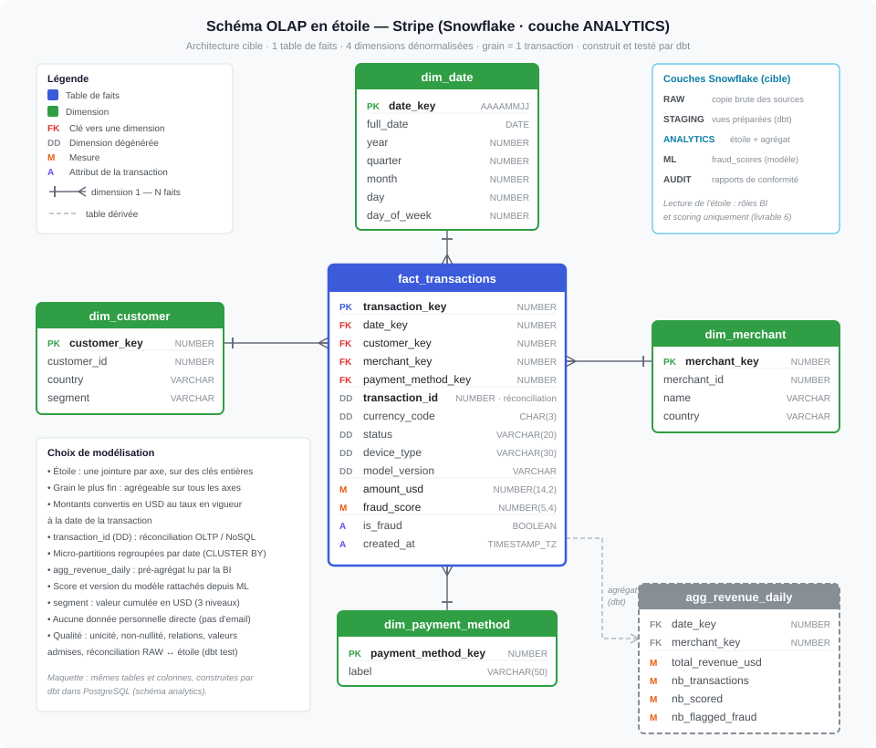

# Livrable 3 : conception du schéma OLAP (Snowflake)

**Énoncé :** un schéma en étoile ou en flocon pour les requêtes et agrégations complexes ; une
stratégie pour les jointures à grande échelle, les sous-requêtes et les séries temporelles ; un
plan de pré-agrégations, vues matérialisées ou tables de synthèse.

| Fichier | Contenu |
|---|---|
| [`etoile_olap.svg`](etoile_olap.svg) | schéma en étoile, couches de l'entrepôt, choix de modélisation |
| [`schema_olap_snowflake.sql`](schema_olap_snowflake.sql) | entrepôts virtuels, couches RAW / STAGING / ANALYTICS / ML / AUDIT, tables |

---

## 1. Rôle

L'OLAP répond aux questions **analytiques** : revenus, fraude par segment, performance des moyens
de paiement, historique de conformité. Il lit beaucoup, écrit par lots, et ne doit jamais
ralentir l'OLTP : il est alimenté par le pipeline (livrable 5).

Technologie : **Snowflake** — stockage séparé du calcul, un entrepôt virtuel par usage
(chargement, transformation, BI), dimensionné et suspendu indépendamment.

## 2. Couches

| Couche | Contenu | Écrite par | Lue par |
|---|---|---|---|
| `RAW` | copie fidèle des sources + `_loaded_at`, sans donnée personnelle directe | Snowpipe Streaming depuis Kafka (transactions, clients, commerçants) ; Airbyte (référentiels) — rôle `loader` | dbt |
| `STAGING` | `stg_transactions` : conversion USD, score rattaché | dbt (`transformer`) | dbt |
| `ANALYTICS` | étoile + pré-agrégat | dbt | BI, scoring |
| `ML` | `fraud_scores` : score, version du modèle, date | scores en ligne via Kafka ; rattrapage (`ml_scorer`) | dbt |
| `AUDIT` | `compliance_reports` | DAG de conformité (`auditor`) | auditeur |

Séparer RAW et ANALYTICS, c'est le principe **ELT** : une erreur de transformation se corrige en
rejouant dbt, sans réextraire les sources.

## 3. Le schéma en étoile

**Grain : une ligne de `fact_transactions` = une transaction.**

| Table | Rôle | Colonnes clés |
|---|---|---|
| `fact_transactions` | faits | 4 clés de dimension ; dimensions dégénérées `transaction_id`, `currency_code`, `status`, `device_type`, `model_version` ; mesures `amount_usd`, `fraud_score` |
| `dim_date` | quand ? | `date_key` AAAAMMJJ, année, trimestre, mois, jour, jour de semaine |
| `dim_customer` | qui paie ? | pays, `segment` (`high_value` ≥ 5 000 USD, `regular` ≥ 500, sinon `occasional`) |
| `dim_merchant` | chez qui ? | nom, pays |
| `dim_payment_method` | comment ? | libellé (jamais de numéro de carte) |
| `agg_revenue_daily` | pré-agrégat | revenus, volumes et fraudes par jour et par commerçant |

**Étoile plutôt que flocon** : les dimensions sont petites et lues en permanence ; les dénormaliser
supprime une jointure par requête pour un coût de stockage négligeable.

**Choix de modélisation :** clés de substitution entières (clés naturelles conservées pour la
traçabilité) · `transaction_id` en dimension dégénérée, clé de réconciliation de
l'architecture · montants convertis en USD au taux du jour, donc additifs ·
score et `model_version` rattachés depuis `ML.FRAUD_SCORES`, pour savoir quel modèle a produit
chaque score · le segment d'un client est recalculé à chaque passage et remplace l'ancien, sans
historique (dimension à évolution lente de type 1 ; un *snapshot* dbt passerait en type 2) ·
aucune donnée personnelle directe.

## 4. Performance

**Jointures** : une seule jointure par axe, sur clés entières, entre une grande table de faits et
de petites dimensions — le cas le plus favorable au moteur. Les micro-partitions de la table de
faits sont regroupées par date (`CLUSTER BY (date_key)`) : une requête sur un mois n'en lit qu'une
fraction. Aux heures de pointe, l'entrepôt de la BI ajoute des ressources (multi-cluster).

**Sous-requêtes** : transformations écrites en **CTE** dans les modèles dbt (lisibles, testables,
réutilisables par `ref()`) ; les sous-requêtes coûteuses sont remplacées par une jointure
latérale (`LATERAL`) limitée à une ligne (exemple : le taux de change en vigueur à la date) ou par
une fonction de fenêtre.

**Séries temporelles** : `dim_date` est **continue**, donc les courbes n'ont pas de trou ;
fonctions de fenêtre pour moyenne mobile 7 jours, cumul, comparaison à la période précédente
(requête Q10) ; le regroupement par date sert aussi l'historique.

**Pré-agrégations :**

| Mécanisme | Utilisation |
|---|---|
| table de synthèse `agg_revenue_daily` | reconstruite par dbt après les faits ; lue par les tableaux de bord (Q3) |
| vue matérialisée Snowflake (option) | agrégat mono-table très sollicité, maintenu par Snowflake |
| cache de résultats | requête identique servie sans recalcul pendant 24 h |
| modèle incrémental dbt (forte volumétrie) | seules les nouvelles transactions sont traitées (fusion sur `transaction_id`) |

**Historique et quasi temps réel** : RAW conserve tout l'historique chargé et reçoit chaque
transaction en moins d'une minute (voie flux) ; elle apparaît dans l'étoile au plus 10 minutes après
le paiement, avec son score (cohérence à terme, livrable 5 §10). La colonne technique `_loaded_at`
de `fact_transactions` garde l'heure d'arrivée dans RAW : elle sert de filigrane au test de
réconciliation.

## 5. Qualité : tests dbt

Exécutés à chaque passage, **avant** le scoring ; un échec arrête le DAG.

| Test | Portée |
|---|---|
| unicité et non-nullité des clés | dimensions, `fact_transactions` |
| relations faits → dimensions | 4 clés |
| valeurs admises | `status`, `segment` |
| règles métier | `amount_usd > 0`, `fraud_score` ∈ [0,1] |
| réconciliation | aucune transaction de RAW absente de l'étoile |
| fraîcheur des sources | avertissement à 15 min, échec à 60 min |

## 6. Où vivent les données analytiques de l'énoncé

| Donnée demandée | Emplacement |
|---|---|
| revenus quotidiens, hebdomadaires, mensuels | `agg_revenue_daily` + `dim_date` |
| segmentation client | `dim_customer.segment` |
| performance des produits | `fact_transactions.status` × `dim_payment_method` (Q12) |
| analyse de la fraude | `fraud_score`, `is_fraud`, `model_version` ; `ML.FRAUD_SCORES` |
| journaux de conformité | `AUDIT.COMPLIANCE_REPORTS` |

## 7. Dans la maquette

L'entrepôt est joué par **PostgreSQL**, avec les **mêmes couches, tables et colonnes**, construites
et testées par les **mêmes modèles dbt** ([`maquette/dbt_stripe`](../maquette/dbt_stripe)).

Écarts : pas de regroupement par date (clustering), d'entrepôts virtuels ni de cache de
résultats ; les tables de l'étoile sont reconstruites entièrement à chaque passage, ce qui
suffit au volume de la maquette.
