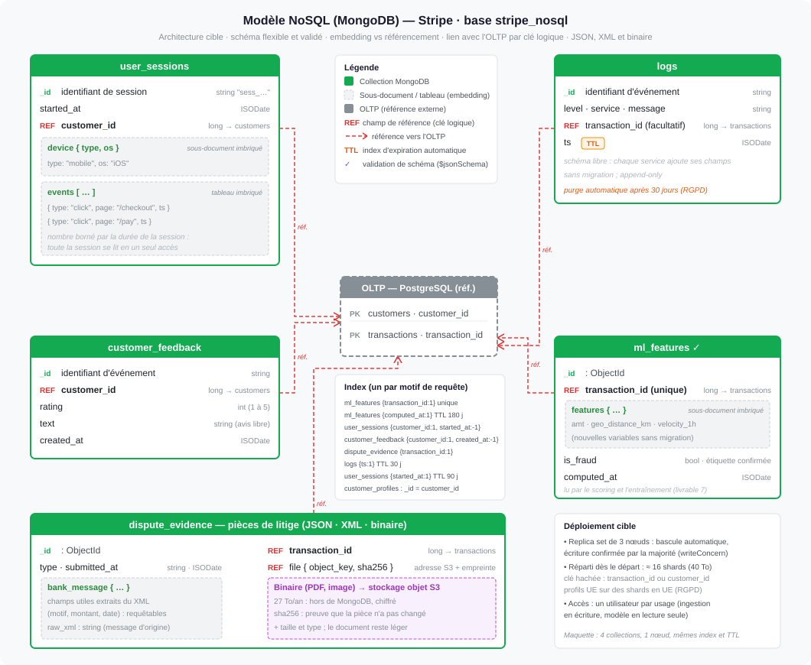

# Livrable 4 : modèle de données NoSQL (MongoDB)

**Énoncé :** un schéma pour les données non structurées et semi-structurées (JSON, XML, binaire) ;
des stratégies pour les relations entre documents (imbrication, référencement, indexation) ;
l'intégration avec l'OLTP et l'OLAP.

| Fichier | Contenu |
|---|---|
| [`modele_nosql.svg`](modele_nosql.svg) | collections, imbrications, références, index, déploiement |
| [`collections_mongodb.js`](collections_mongodb.js) | script mongosh : collections, validation, index, sharding, documents types |

---

## 1. Rôle

MongoDB reçoit ce que le relationnel gère mal : structures **variables** (journaux, avis libres),
données **imbriquées** (une session et ses clics), volumes d'événements élevés, **pièces jointes**
(XML, PDF, images). C'est aussi le **magasin de features** du modèle de fraude (livrable 7).

Technologie : **MongoDB** — le document JSON est la forme naturelle des événements applicatifs, et
le schéma reste flexible tout en pouvant être validé là où c'est nécessaire.

## 2. Les collections

| Collection | Données de l'énoncé | Forme du document | Référence |
|---|---|---|---|
| `user_sessions` | flux de clics, sessions | session + `device {}` + `events []` imbriqués | `customer_id` → OLTP |
| `customer_feedback` | avis, enquêtes | document plat, schéma libre | `customer_id` → OLTP |
| `logs` | journaux d'erreurs et d'accès | plat, champs propres à chaque service | `transaction_id` (facultatif) |
| `ml_features` | caractéristiques d'apprentissage | `features {}` + étiquette `is_fraud` | `transaction_id` (index unique) |
| `dispute_evidence` | XML et binaire | champs extraits du XML + XML d'origine + fichier GridFS | `transaction_id`, `file_id` |
| `customer_profiles` | personnalisation (livrable 7) | un document par client : segment comportemental, recommandations | `_id` = `customer_id` |

## 3. Imbriquer ou référencer

La règle : **on modélise selon les requêtes**, pas selon les entités.

**Imbriquer** quand les données sont lues et écrites ensemble (appareil et clics d'une session),
que leur nombre est borné (le validateur limite `events` à 1 000) et qu'elles n'ont pas de vie
propre (variables d'une ligne de features).

**Référencer** quand la donnée maître vit ailleurs (client et transaction restent dans l'OLTP),
que la relation est non bornée (sessions d'un client) ou que l'objet est volumineux (fichier dans
GridFS, seul `file_id` est conservé).

MongoDB ne joint pas PostgreSQL : la « jointure » est **logique** — on lit la transaction dans
l'OLTP, puis ses features par `transaction_id` (index unique). `$lookup` reste possible en interne,
mais pas dans les chemins critiques.

## 4. JSON, XML et binaire

| Format | Stratégie |
|---|---|
| **JSON** | format natif (BSON) : événements, sessions, avis, features |
| **XML** (messages bancaires de rétrofacturation) | champs utiles **extraits** en sous-document `bank_message` (requêtables, indexables) ; message d'origine **conservé** dans `raw_xml` pour l'audit |
| **Binaire** (PDF, images) | stocké dans le document jusqu'à 16 Mo (`BinData`) ; au-delà, **GridFS** découpe le fichier et le document ne porte que `file_id` |

## 5. Schéma flexible, mais contrôlé

- **Validation `$jsonSchema`** là où un traitement en dépend : `ml_features` (`transaction_id`,
  `features` avec `amt`, `geo_distance_km`, `velocity_1h`, `computed_at`), `user_sessions`,
  `dispute_evidence`.
- **Schéma libre** pour `logs` et `customer_feedback` : un nouveau service ajoute ses champs sans
  migration.
- **Étiquette tardive** : `is_fraud` vaut `null` à la création, renseignée quand la fraude est
  confirmée (rétrofacturation, enquête), parfois des semaines plus tard.

## 6. Index

| Index | Requête servie |
|---|---|
| `ml_features {transaction_id: 1}` **unique** | features d'une transaction (scoring) |
| `ml_features {computed_at: -1}` | fenêtre récente pour la dérive et l'entraînement |
| `user_sessions {customer_id: 1, started_at: -1}` | parcours d'un client |
| `customer_feedback {customer_id: 1, created_at: -1}` | avis d'un client |
| `dispute_evidence {transaction_id: 1}` | pièces d'un litige |
| `logs {ts: 1}` **TTL** | purge automatique à 30 jours (minimisation RGPD) |

Un index par motif de requête fréquent, et pas plus : chaque index ralentit les écritures.

## 7. Déploiement cible

- **Replica set de 3 nœuds** : bascule automatique, et une écriture n'est confirmée que lorsque la
  majorité des nœuds l'a reçue (`writeConcern: majority`).
- **Sharding** au-delà de la capacité d'un nœud : `transaction_id` répartit `ml_features` et
  `dispute_evidence`, `customer_id` répartit `user_sessions` et `customer_feedback`. La répartition
  se fait sur une **clé hachée**, pour que des identifiants qui se suivent ne partent pas tous sur
  le même serveur.
- **Transactions multi-documents** disponibles sur replica set.
- **Accès** : un utilisateur par usage ; l'ingestion écrit, le modèle ne fait que lire.

## 8. Intégration OLTP et OLAP

| Flux | Mécanisme |
|---|---|
| Application → MongoDB | ingestion en écritures idempotentes (upsert sur l'identifiant d'événement ou `transaction_id`) |
| MongoDB ↔ OLTP | références logiques `customer_id`, `transaction_id` ; aucune donnée maître dupliquée |
| MongoDB → OLAP | le modèle lit les features, écrit le score dans `ML.FRAUD_SCORES`, que dbt rattache aux faits ; le même score est réécrit dans l'OLTP |
| Réconciliation | une transaction se retrouve dans les trois systèmes par `transaction_id` (livrable 8) |

## 9. Dans la maquette

MongoDB 7 sur **un seul nœud**
([`maquette/init/mongo/01-users-and-indexes.js`](../maquette/init/mongo/01-users-and-indexes.js)) :
collections `ml_features`, `user_sessions`, `customer_feedback` et `logs`, mêmes index, validation
de `ml_features`, deux utilisateurs (`el_loader` en écriture, `ml_reader` en lecture).

Non reproduits : `dispute_evidence` et GridFS, `customer_profiles`, la validation de
`user_sessions`, le replica set, le sharding. L'étiquette `is_fraud` y est fournie dès l'émission
de l'événement, pour pouvoir entraîner sans attendre.
