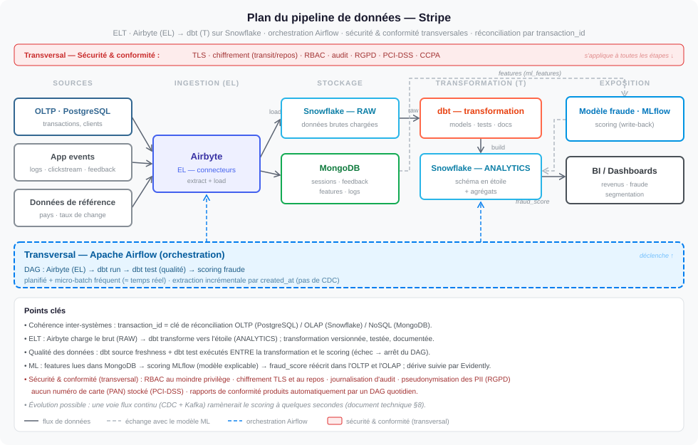

# Livrable 5 : architecture du pipeline de données (document technique)

**Énoncé :** un pipeline assurant un flux cohérent entre l'OLTP, l'OLAP et le NoSQL, avec des
composants par lots et en flux ; les outils d'orchestration ; les mécanismes d'intégration, de
synchronisation et de cohérence ; l'évolutivité (indexation, partitionnement, cache).

## Plans

| Fichier | Question |
|---|---|
| [`00_plan_pipeline_cible.svg`](00_plan_pipeline_cible.svg) | comment la donnée circule, de la source à la consommation |
| [`11_dags_orchestration.svg`](11_dags_orchestration.svg) | dans quel ordre tournent les tâches ; que se passe-t-il en cas d'échec ou de dérive |
| [`12_flux_donnees_par_couche.svg`](12_flux_donnees_par_couche.svg) | où vit chaque table, qui la déplace, avec quel rôle |
| [`13_deploiement_supervision.svg`](13_deploiement_supervision.svg) | déploiement et supervision |
| [`10_plan_pipeline_maquette.svg`](10_plan_pipeline_maquette.svg) | le pipeline reproduit dans la maquette |
| [`20_plan_pipeline_cible_et_maquette.svg`](20_plan_pipeline_cible_et_maquette.svg) | cible et maquette sur une même grille |



---

## 1. Principes

1. **ELT** : charger le brut, transformer dans l'entrepôt. Une erreur se corrige en rejouant dbt.
2. **Une clé de réconciliation** : `transaction_id` relie l'OLTP, l'OLAP et MongoDB.
3. **Une barrière qualité avant toute valorisation** : aucune donnée non validée n'atteint le modèle.
4. **Idempotence** : relancer une tâche ne crée ni doublon ni incohérence.
5. **Moindre privilège** : chaque tâche a son rôle (livrable 6).
6. **L'échec est l'alerte** : une tâche en échec bloque l'aval.

## 2. Composants

| Étape | Outil cible | Pourquoi |
|---|---|---|
| Sources | OLTP PostgreSQL, événements applicatifs, référentiels | l'application vit hors du pipeline |
| Ingestion (EL) | **Airbyte** | connecteurs prêts, modes incrémental et complet, état des synchronisations géré |
| Stockage analytique | **Snowflake** (RAW, STAGING, ANALYTICS, ML, AUDIT) | calcul séparé du stockage (livrable 3) |
| Stockage documents | **MongoDB** | événements semi-structurés, magasin de features (livrable 4) |
| Transformation (T) | **dbt** | SQL versionné, testé, dépendances calculées |
| Qualité | **dbt test** + **source freshness** | tests déclarés à côté des modèles |
| Valorisation | **MLflow** + **Evidently** | cycle de vie du modèle (livrable 7) |
| Exposition | outil de BI sur ANALYTICS | livrable 8 |
| Orchestration | **Apache Airflow** | ordre, planification, reprises, historique |
| Déploiement | **Docker** + **GitHub Actions** | même image du développement à la production |

## 3. Les flux

Détail table par table : [`12_flux_donnees_par_couche.svg`](12_flux_donnees_par_couche.svg).

| # | De | Vers | Par | Rôle |
|---|---|---|---|---|
| 1 | OLTP : transactions, clients, commerçants, moyens de paiement | `RAW` | Airbyte, incrémental ou complet | lecture seule, sans l'email |
| 2 | référentiels : pays, taux de change | `RAW` | Airbyte, rechargement complet | chargement |
| 3 | événements applicatifs | MongoDB (4 collections) | Airbyte, incrémental, upsert | écriture MongoDB |
| 4 | `RAW` + `ML.FRAUD_SCORES` | `STAGING` → `ANALYTICS` | dbt run | transformation |
| 5 | `ANALYTICS` | contrôle | source freshness + dbt test | transformation |
| 6 | `ANALYTICS` validées + `ml_features` | `ML.FRAUD_SCORES` + OLTP `fraud_score` | scoring | écriture de la seule colonne `fraud_score` |
| 7 | `ANALYTICS` | BI | requêtes SQL | lecture de l'étoile |

## 4. Ingestion (EL)

| Flux | Mode | Curseur / clé |
|---|---|---|
| `transactions`, `customers`, `merchants` | **incrémental dédupliqué** | `created_at` ; dédoublonnage sur la PK |
| `payment_methods`, `countries`, `exchange_rates` | **rechargement complet** | petites tables |
| événements applicatifs | **incrémental** | dernier fichier lu ; upsert sur l'identifiant d'événement ou `transaction_id` |

**Garanties :**
- **Pas de trou sur les validations tardives** : chaque passage relit depuis
  `dernier curseur − 10 minutes` ; les lignes relues sont absorbées par l'upsert.
- **Cohérence référentielle** : toutes les tables de l'OLTP sont lues dans un même instantané
  (`REPEATABLE READ`) — jamais une transaction sans son client ni son commerçant.
- **Atomicité du chargement** : lignes et nouveau curseur écrits dans la même transaction. Si le
  chargement échoue, le curseur n'avance pas.
- **Registre en ajout seul** : rien n'est modifié après insertion, sauf `fraud_score` (non
  extrait) — c'est ce qui rend le curseur `created_at` suffisant (limite au §9.4).
- **Minimisation RGPD** : le rôle d'ingestion ne peut pas lire `customers.email`.
- **Traçabilité** : `_loaded_at` sur chaque ligne de RAW, état de chaque flux conservé.

## 5. Transformation et qualité

`dbt run` construit, dans l'ordre des dépendances : `stg_transactions` (conversion USD, score
rattaché) → dimensions → `fact_transactions` → `agg_revenue_daily` (livrable 3).

Puis `dbt source freshness` et `dbt test` dans la tâche `dbt_test_quality` : fraîcheur de RAW
(avertissement 15 min, échec 60 min), unicité et non-nullité des clés, relations faits →
dimensions, valeurs admises, règles métier (`amount_usd > 0`, `fraud_score` entre 0 et 1),
réconciliation RAW ↔ étoile. **Un échec arrête le DAG avant le scoring.**

## 6. Les trois DAG

Détail : [`11_dags_orchestration.svg`](11_dags_orchestration.svg).

| DAG | Planification | Tâches | Garde-fous |
|---|---|---|---|
| `stripe_pipeline` | 5 min | `el_sync` (3 synchros parallèles) → `dbt_transform` → `dbt_test_quality` → `fraud_scoring` | `max_active_runs = 1` ; 2 tentatives à 2 min ; pas de champion → scoring *skipped* |
| `stripe_model_retraining` | quotidien ou à la demande | `check_drift` → `train_candidate` → `promote_if_better`, ou `no_retraining_needed` | entraînement reporté sous 200 transactions étiquetées ou 10 fraudes ; promotion conditionnelle (livrable 7) |
| `stripe_compliance_daily` | quotidien | `run_compliance_checks` → `assert_blocking_controls` | un contrôle bloquant en échec fait échouer le DAG (livrable 6) |

Trois DAG plutôt qu'un seul : les rythmes diffèrent, et un réentraînement long ou un contrôle en
échec ne doit pas retarder l'alimentation de l'entrepôt.

## 7. Latence

L'architecture fonctionne en **micro-batch toutes les 5 minutes**, ce qui couvre à la fois le
traitement par lots (DAG quotidiens, rechargements, pré-agrégats) et une synchronisation proche du
temps réel.

| Donnée | Délai maximal |
|---|---|
| transaction dans l'étoile | ≈ 5 min |
| événement dans MongoDB | ≈ 5 min |
| score de fraude dans l'OLTP | ≈ 5 min après l'arrivée des features |
| score de fraude dans l'étoile | ≈ 10 min (au passage suivant) |
| rapport de conformité | quotidien |

Choix assumé : quelques minutes suffisent pour l'analyse, la supervision de la fraude et la
conformité, et l'architecture reste simple (pas de bus de messages à exploiter).

## 8. Évolution : une voie flux continu

Si le métier exige un score en quelques secondes (bloquer un paiement avant autorisation), une
voie de flux s'ajoute **en complément** de la voie par lots. Ces outils ne font pas partie de ceux
que j'ai pratiqués : je les cite comme piste, sans les avoir mis en œuvre.

| Étape | Composant |
|---|---|
| capture des changements de l'OLTP | lecture du journal des transactions PostgreSQL, le WAL (par exemple Debezium) |
| transport | Kafka : sujets `transactions`, `app_events` |
| scoring en flux | service consommateur chargeant le champion depuis MLflow |
| alimentation continue | connecteurs Kafka vers MongoDB et vers l'entrepôt (Snowpipe Streaming) |

Ne changeraient pas : les couches, les modèles dbt, les tests, la clé `transaction_id`, le registre
et les contrôles de conformité — les écritures sont déjà idempotentes. À ajouter : un cluster Kafka
à exploiter et la gestion des doublons et du hors-ordre. Voie non retenue dans la cible actuelle.

## 9. Cohérence et synchronisation

### 9.1 Une source de vérité par donnée

| Donnée | Source de vérité | Copies |
|---|---|---|
| transactions, clients, commerçants | OLTP | RAW, étoile |
| événements, features | MongoDB | aucune |
| score de fraude | `ML.FRAUD_SCORES` | `fraud_score` (OLTP), `fact_transactions` |
| référentiels | fichiers et API de référence | RAW |

### 9.2 Conflits : évités par construction

**Un seul écrivain par donnée** (seul le scoring écrit `fraud_score`, avec un droit limité à cette
colonne ; l'ingestion n'écrit que RAW et MongoDB ; dbt que STAGING et ANALYTICS) · copies pilotées
par la source (upsert sur la clé) · un score écrit une seule fois par transaction
(`ON CONFLICT DO NOTHING`), rescorer étant une décision explicite tracée par `model_version` · pas
d'exécutions concurrentes d'un même DAG.

### 9.3 Cohérence à terme, assumée et mesurée

Les trois systèmes convergent en un ou deux passages : une transaction peut être dans l'étoile sans
score, et sera scorée quand ses features arrivent. L'écart est **mesuré** (requête Q5) et la
réécriture du score dans l'OLTP est **auto-réparante**.

### 9.4 Limites connues

- Le curseur `created_at` ne voit pas les **modifications** de clients ou de commerçants : il
  faudrait un `updated_at` mis à jour par déclencheur, ou le mode CDC.
- Les **suppressions** ne sont pas propagées — cohérent avec un registre financier, où l'effacement
  RGPD est une anonymisation (livrable 6).

## 10. Évolutivité

| Composant | Montée en charge | Index, partitionnement | Cache |
|---|---|---|---|
| OLTP | réplicas de lecture ; écritures sur le primaire | index ciblés, index partiel des transactions à scorer ; partitionnement mensuel | — |
| Snowflake | entrepôt virtuel par usage ; ressources ajoutées quand les requêtes s'accumulent (multi-cluster) | micro-partitions regroupées par date (clustering) | résultats (24 h), `agg_revenue_daily` |
| MongoDB | répartition par clé hachée (sharding) ; replica set | index par motif ; purge automatique des journaux | cache mémoire du moteur |
| Airflow | exécuteur distribué (Celery, Kubernetes) | — | — |
| Airbyte | workers supplémentaires | — | état des flux |
| Scoring | lots de 5 000 par passage | index unique `ml_features.transaction_id` | modèle chargé une fois |

## 11. Déploiement et supervision

Voir [`13_deploiement_supervision.svg`](13_deploiement_supervision.svg).

**Déploiement** : code versionné dans Git ; **GitHub Actions** teste, construit l'image **Docker**
et la déploie. Airflow sur un serveur dédié ; Snowflake, MongoDB et PostgreSQL managés ; MLflow sur
Hugging Face Spaces (base PostgreSQL, artefacts S3). Un secret par rôle, dans un coffre.

**Supervision** :

| Quoi | Comment | Alerte |
|---|---|---|
| exécution des tâches | interface Airflow | échec après les tentatives |
| fraîcheur | `dbt source freshness`, état des flux | 15 min (avert.), 60 min (échec) |
| qualité | `dbt test`, réconciliation RAW ↔ étoile | échec = scoring bloqué |
| modèle | MLflow : métriques, dérive, versions | dérive → réentraînement |
| conformité | rapport quotidien historisé | contrôle bloquant en échec |
| accès | journaux des bases | revue dans le rapport de conformité |

**Ce qui change dans le code entre la maquette et la cible** — seuls le connecteur d'ingestion et
la connexion dbt. Les deux extraits ci-dessous sont donnés pour montrer ce qui changerait : ils ne
sont pas exécutés dans ce projet.

```python
# stripe_pipeline, version cible : le groupe el_sync déclenche les connexions Airbyte
from airflow.providers.airbyte.operators.airbyte import AirbyteTriggerSyncOperator

with TaskGroup("el_sync") as el_sync:
    for name, connection_id in AIRBYTE_CONNECTIONS.items():   # oltp, référentiels, événements
        AirbyteTriggerSyncOperator(
            task_id=f"airbyte_{name}",
            airbyte_conn_id="airbyte",
            connection_id=connection_id,
            asynchronous=False,
            timeout=900,
        )

el_sync >> dbt_transform >> dbt_test_quality >> fraud_scoring   # inchangé
```

```yaml
# dbt_stripe/profiles.yml, cible Snowflake (la maquette utilise type: postgres)
dbt_stripe:
  target: prod
  outputs:
    prod:
      type: snowflake
      account: "{{ env_var('SNOWFLAKE_ACCOUNT') }}"
      role: TRANSFORMER
      warehouse: WH_TRANSFORMING
      database: STRIPE_DWH
      schema: STAGING
      threads: 8
```

## 12. Dans la maquette

La [maquette](../maquette/README.md) reproduit ce pipeline **à l'identique dans ses étapes, son
ordre, ses couches, ses trois DAG, ses rôles et ses tests**. Substitutions :

| Cible | Maquette | Raison |
|---|---|---|
| Airbyte | tâches Python `el_sync`, mêmes modes et même recouvrement de 10 min | Airbyte demande une dizaine de conteneurs |
| Snowflake | PostgreSQL, mêmes couches et tables | service cloud payant |
| Evidently | PSI par variable, suivi dans MLflow | même décision, sans dépendance |
| outil de BI | requêtes SQL (rôle `data_analyst`) | mêmes questions métier |
| application et flux d'événements | simulateur : OLTP + fichiers JSON Lines | données synthétiques |
| serveurs managés, CI/CD | Docker Compose, 6 conteneurs | démonstration locale |

Non reproduits : TLS et chiffrement au repos, réplication et bascule, partitionnement, montée en
charge, déploiement continu.
