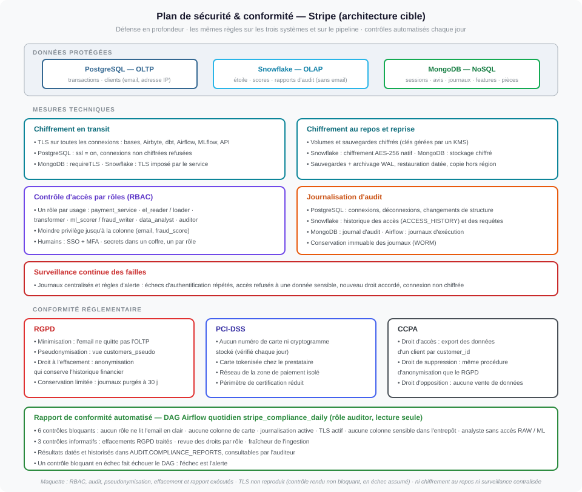

# Livrable 6 : plan de sécurité et de conformité

**Énoncé :** un cadre de sécurité (chiffrement, contrôle d'accès par rôles, journalisation
d'audit) ; des stratégies de conformité RGPD, PCI-DSS et CCPA ; la production et le suivi
automatisés des rapports de conformité ; la surveillance en temps réel des failles.

| Fichier | Contenu |
|---|---|
| [`securite_conformite.svg`](securite_conformite.svg) | données protégées, mesures techniques, conformité, rapport automatisé |

Mise en œuvre exécutable : [`init/oltp/02-security.sh`](../maquette/init/oltp/02-security.sh),
[`init/warehouse/01-layers-and-roles.sh`](../maquette/init/warehouse/01-layers-and-roles.sh),
[`init/mongo/01-users-and-indexes.js`](../maquette/init/mongo/01-users-and-indexes.js),
[`pipeline/compliance.py`](../maquette/pipeline/compliance.py) et
[`dags/stripe_compliance_daily.py`](../maquette/dags/stripe_compliance_daily.py).



---

## 1. Ce qu'il faut protéger

| Donnée | Où | Règle |
|---|---|---|
| email du client | OLTP `customers` | ne quitte jamais l'OLTP, pas même par la capture des changements (colonne exclue de la publication) ; lu par l'application seulement |
| adresse IP | OLTP, RAW | masquée dans RAW pour les rôles humains ; absente de l'étoile |
| numéro de carte, cryptogramme | **nulle part** | carte tokenisée chez le prestataire ; aucune colonne de carte autorisée |
| transactions, montants, scores | OLTP, entrepôt | accès par rôle, au moindre privilège |
| sessions, avis, journaux | MongoDB | conservation limitée (journaux : 30 jours) |
| rapports de conformité | entrepôt `AUDIT` | écrits et lus par l'auditeur seulement |

## 2. Chiffrement

**En transit** : TLS sur toutes les connexions (bases, Kafka, Debezium, Airbyte, dbt, Airflow,
MLflow, service de scoring, API).
Configuration type pour n'accepter que des connexions chiffrées :

```conf
# postgresql.conf
ssl = on
ssl_min_protocol_version = 'TLSv1.2'

# pg_hba.conf : seules les connexions chiffrées sont acceptées
hostssl  all  all  0.0.0.0/0  scram-sha-256
hostnossl all all  0.0.0.0/0  reject
```

MongoDB : `net.tls.mode: requireTLS`. Snowflake n'accepte que du TLS.

**Kafka** : connexions chiffrées et authentifiées (TLS + SASL/SCRAM, ou certificats clients) ;
**une autorisation (ACL) par topic et par service** : l'API de paiement n'écrit que ses topics,
chaque connecteur ne lit que les siens, personne ne lit `cdc.oltp.*` sauf le connecteur vers RAW.

```properties
# server.properties (extrait)
listeners=SASL_SSL://0.0.0.0:9093
sasl.enabled.mechanisms=SCRAM-SHA-512
authorizer.class.name=org.apache.kafka.metadata.authorizer.StandardAuthorizer
allow.everyone.if.no.acl.found=false
```

**Au repos** : volumes et sauvegardes PostgreSQL et MongoDB, disques des brokers Kafka chiffrés,
clés gérées par un KMS ;
Snowflake chiffre nativement (AES-256).

**Sauvegardes et reprise** : détail, plan de reprise d'activité et tests réguliers dans le
[livrable 5 §9.4 à 9.6](../05_pipeline/README.md). Les copies de sauvegarde sont **immuables**
(verrouillage objet) : un rançongiciel ne peut ni les chiffrer ni les supprimer.

**Sauvegardes** : sauvegarde quotidienne et archivage continu des journaux de transactions (WAL), ce
qui permet de restaurer la base à un instant précis ; copie chiffrée dans une autre région
(livrable 2).

## 3. Contrôle d'accès par rôles (RBAC)

Un rôle par usage, avec les seuls droits nécessaires, **jusqu'à la colonne**. Les mêmes rôles
existent dans la cible et dans la maquette.

| Rôle | Système | Droits | Refusé |
|---|---|---|---|
| `payment_service` | OLTP | référentiels en lecture ; `SELECT`, `INSERT` sur clients, commerçants, transactions | modifier ou supprimer une transaction |
| `cdc_reader` (Debezium) | OLTP | réplication (lecture du journal) ; tables publiées ; sur `customers`, seulement `customer_id`, `country_code`, `created_at` | **`customers.email`** ; toute écriture |
| `capacity_monitor` | OLTP | `SELECT (created_at)` sur les transactions ; exécuter `ensure_monthly_partitions` | toute autre colonne ; toute écriture de données |
| `fraud_writer` | OLTP | `SELECT (transaction_id, fraud_score)`, `UPDATE (fraud_score)` | toute autre colonne |
| `data_analyst` | OLTP | transactions, commerçants, référentiels, vue `customers_pseudo` | table `customers` |
| `loader` | entrepôt | écriture dans `RAW`, dont la quarantaine `RAW._QUARANTINE` | les autres couches |
| `transformer` (dbt) | entrepôt | lecture `RAW` et `ML` ; propriétaire de `STAGING` et `ANALYTICS` | `AUDIT` |
| `ml_scorer` | entrepôt | lecture `ANALYTICS` ; écriture `ML.FRAUD_SCORES` | `RAW` |
| `data_analyst` | entrepôt | lecture de `ANALYTICS` uniquement | **`RAW`** et **`ML`** |
| `auditor` | OLTP, entrepôt | vues d'audit ; écriture `AUDIT.COMPLIANCE_REPORTS` | les données métier |
| `alerter` | entrepôt | ajouter une ligne dans `AUDIT.ALERTS` | toute lecture ; toute autre table |
| `el_loader` / `ml_reader` | MongoDB | écriture / lecture seule de `stripe_nosql` | administration |

**Dans la cible** : SSO et MFA, rôles attribués à des groupes et non à des individus, revue
trimestrielle · un secret par rôle de service dans un coffre, avec rotation, jamais dans Git ·
politique de masquage de l'adresse IP en couche RAW. Exemple de règle, non exécutée dans ce
projet :

```sql
CREATE MASKING POLICY RAW.MASK_IP AS (val VARCHAR) RETURNS VARCHAR ->
  CASE WHEN CURRENT_ROLE() IN ('LOADER', 'TRANSFORMER') THEN val ELSE '***' END;
ALTER TABLE RAW.TRANSACTIONS MODIFY COLUMN ip_geolocation SET MASKING POLICY RAW.MASK_IP;
```

## 4. Journalisation d'audit

| Système | Journalisé |
|---|---|
| PostgreSQL | connexions et déconnexions ; changements de structure (`log_statement = 'ddl'`) |
| Snowflake | historique des accès aux colonnes, des requêtes et des connexions (`ACCESS_HISTORY`, `QUERY_HISTORY`, `LOGIN_HISTORY`) |
| MongoDB | authentifications, créations d'utilisateurs, changements de droits |
| Airflow | chaque exécution : heure, durée, résultat, journal |

Les journaux sont centralisés et conservés dans un **stockage immuable** (WORM) : ils ne peuvent
être ni modifiés ni supprimés pendant leur durée de conservation.

## 5. Surveillance continue des failles

| Événement | Pourquoi c'est suspect |
|---|---|
| échecs d'authentification répétés | force brute |
| accès refusé à une colonne sensible | rôle détourné ou erreur de configuration |
| droit accordé hors procédure | élévation de privilège |
| connexion non chiffrée acceptée | régression TLS |
| extraction inhabituelle (volume, heure) | exfiltration |

Le rapport quotidien (§7) complète cette surveillance : il vérifie que la configuration reste
conforme, même en l'absence d'événement.

## 6. Conformité réglementaire

**RGPD**

| Principe | Mise en œuvre |
|---|---|
| minimisation | l'email n'est jamais extrait ; aucune donnée personnelle directe dans l'étoile |
| pseudonymisation | vue `customers_pseudo` : empreinte de l'email **à clé secrète** (HMAC-SHA256). Une empreinte sans clé (md5, sha256) se retrouverait en calculant celle d'adresses connues ; sans la clé, c'est impossible. La clé n'est lisible par aucun rôle de connexion (cible : coffre / KMS, avec rotation) ; la même adresse donne toujours la même empreinte, ce qui garde les regroupements possibles |
| droit à l'effacement | `erase_customer(id)` : anonymisation irréversible ; l'historique financier est conservé (obligation comptable), le client n'est plus identifiable |
| limitation de conservation | journaux purgés à 30 jours (TTL) ; durées fixées par catégorie |
| responsabilité | rapport quotidien historisé, preuve des contrôles |

**PCI-DSS** : aucune donnée de carte stockée (vérifié chaque jour) · tokenisation chez le
prestataire · segmentation réseau, l'entrepôt n'accède pas à la zone de paiement · conséquence : un
**périmètre réduit** pour les exigences les plus lourdes.

**CCPA** : accès (export à partir de `customer_id`) · suppression (même anonymisation que le
RGPD) · opposition à la vente (aucune donnée n'est vendue ni partagée).

## 7. Rapports de conformité automatisés

**DAG `stripe_compliance_daily`**, quotidien, rôle `auditor` (lecture seule) :
`run_compliance_checks` → `assert_blocking_controls`.

| Contrôle | Système | Type | Règle |
|---|---|---|---|
| `rgpd_pii_access` | OLTP | **bloquant** | aucun rôle hors application ne lit `customers.email` |
| `pci_no_card_data` | OLTP | **bloquant** | aucune colonne de type donnée de carte |
| `audit_logging_enabled` | OLTP | **bloquant** | journalisation active |
| `tls_in_transit` | OLTP | **bloquant** | `ssl = on` |
| `rgpd_pci_no_sensitive_columns` | entrepôt | **bloquant** | ni email ni carte dans RAW, STAGING, ANALYTICS, ML |
| `least_privilege_analyst` | entrepôt | **bloquant** | l'analyste n'accède ni à RAW ni à ML |
| `rgpd_erasure_requests` | OLTP | informatif | clients anonymisés |
| `access_review` | OLTP | informatif | droits par rôle |
| `ingestion_freshness` | entrepôt | informatif | flux non synchronisés depuis plus de 30 min |

Chaque contrôle écrit une ligne datée dans `AUDIT.COMPLIANCE_REPORTS` : l'historique est la preuve.
Si un contrôle bloquant échoue, le DAG passe au rouge et l'alerte part. Les contrôles lisent le
**catalogue système** des bases (droits, colonnes et paramètres réels) : ils vérifient ce qui est
en place, pas ce qui était prévu.

## 8. Dans la maquette

| Mesure | Maquette |
|---|---|
| RBAC au moindre privilège, jusqu'à la colonne | ✅ tous les rôles, une connexion par tâche |
| Journalisation d'audit PostgreSQL | ✅ |
| Pseudonymisation, effacement | ✅ vue `customers_pseudo` (HMAC-SHA256, clé tirée au hasard à l'initialisation, rangée dans le schéma `secrets` fermé à tous les rôles de connexion), fonction `erase_customer` |
| Purge des journaux | ✅ index TTL MongoDB |
| Rapport quotidien | ✅ 9 contrôles historisés ; refus démontrés par [`queries/05_security_demo.sh`](../maquette/queries/05_security_demo.sh) |
| TLS | ❌ pas de certificat ; le contrôle est rendu **non bloquant** et apparaît **en échec assumé** |
| Chiffrement au repos, sauvegardes, surveillance centralisée, SSO/MFA, masquage | ❌ infrastructure dédiée |
| Secrets | un mot de passe commun aux rôles de service, lu dans `.env` (non versionné) |
