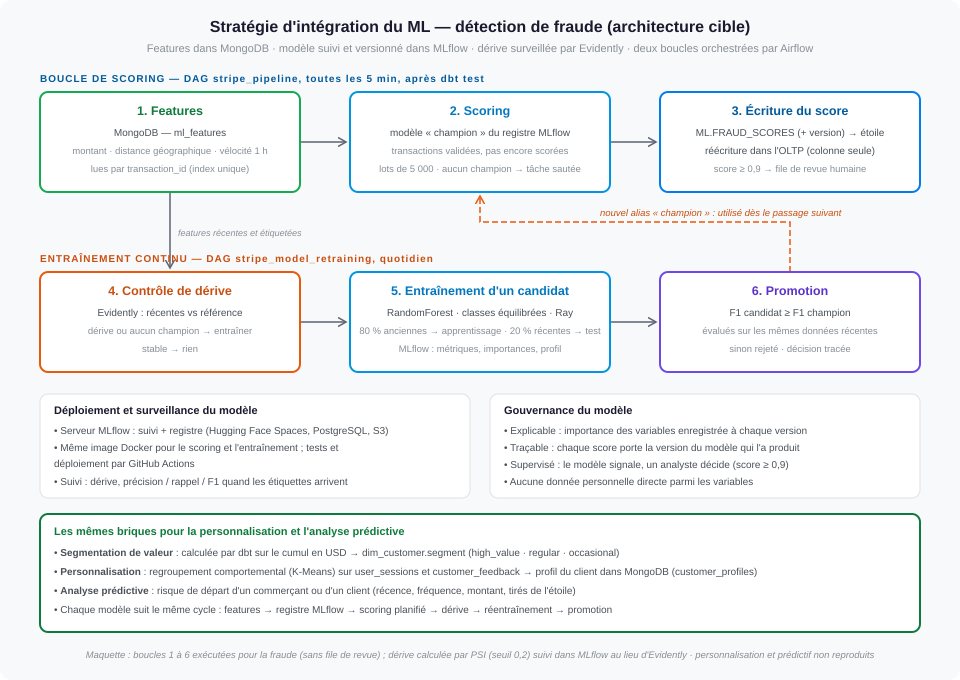

# Livrable 7 : stratégie d'intégration de l'apprentissage automatique

**Énoncé :** un processus d'intégration des modèles au sein du système NoSQL ; des stratégies pour
la détection des fraudes en temps réel, la personnalisation et l'analyse prédictive ; l'extraction
de caractéristiques, le déploiement, la surveillance des performances et la mise à jour.

| Fichier | Contenu |
|---|---|
| [`strategie_ml.svg`](strategie_ml.svg) | les deux boucles (scoring, entraînement continu), déploiement, gouvernance, personnalisation |

Mise en œuvre exécutable : [`pipeline/ml_fraud.py`](../maquette/pipeline/ml_fraud.py),
[`pipeline/scoring_api.py`](../maquette/pipeline/scoring_api.py) (scoring en ligne),
[`dags/stripe_pipeline.py`](../maquette/dags/stripe_pipeline.py) (tâche `fraud_scoring_catch_up`),
[`dags/stripe_model_retraining.py`](../maquette/dags/stripe_model_retraining.py).

---

## 1. Le ML branché sur les trois systèmes

| Système | Rôle pour le ML |
|---|---|
| **MongoDB** | **magasin de features** en ligne (profil du client lu pendant le paiement) et pour l'entraînement (`ml_features`, un document par transaction, avec l'étiquette quand elle est connue) ; comportements pour la personnalisation ; profils calculés |
| **Snowflake** | réception des scores (`ML.FRAUD_SCORES`), historique et features agrégées |
| **OLTP** | enregistre le score avec la transaction, au moment du paiement (`fraud_score`) |
| **MLflow** | suivi des entraînements, registre des versions, alias `champion` |
| **Kafka** | transport des features et des scores vers MongoDB et Snowflake |
| **Airflow** | orchestration du rattrapage et de l'entraînement continu |

La clé `transaction_id` relie features, transaction et fait : chaque score est rattachable à ses
entrées et à la version du modèle qui l'a produit.

## 2. Extraction des caractéristiques

| Feature | Signification |
|---|---|
| `amt` | montant de la transaction |
| `geo_distance_km` | distance entre la localisation de la transaction et celle du client |
| `velocity_1h` | nombre de transactions du client dans l'heure précédente |

- Calculées **par l'application au moment du paiement**, là où le contexte existe, puis émises
  comme événements et chargées dans `ml_features` : le modèle lit exactement ce qui a été calculé,
  **sans écart entre entraînement et production**.
- **Schéma validé** (livrable 4) ; une nouvelle feature s'ajoute sans migration.
- **Étiquette tardive** : `is_fraud` est renseignée à la confirmation de la fraude ; seules les
  transactions étiquetées servent à l'entraînement.
- Aucune donnée personnelle directe parmi les features.

## 3. Boucle de scoring

### 3.1 En ligne, pendant le paiement (chemin synchrone)

Le score est calculé **avant** d'accepter le paiement, en moins de 100 ms (livrable 0 §4.4) :

1. l'API de paiement calcule les features ; l'historique récent du client (vélocité, pays
   habituels) est lu dans son profil MongoDB (`customer_profiles`), tenu à jour en quelques
   secondes par la voie flux : **MongoDB sert de magasin de features en ligne** ;
2. elle appelle le **service de scoring**, qui garde le modèle **`champion`** en mémoire et le
   recharge quand l'alias change dans le registre MLflow ;
3. score **< 0,9** → paiement accepté ; score **≥ 0,9** → **authentification renforcée** du client
   (3-D Secure) et file de **revue humaine** : le modèle signale, un analyste décide ;
4. la transaction est enregistrée dans l'OLTP **avec son score** ; l'API publie ensuite les
   features (`events.risk_features` → `ml_features`) et le score avec la **version du modèle**
   (`fraud.scores` → `ML.FRAUD_SCORES`, que dbt rattache à `fact_transactions`).

**Service indisponible ou trop lent (300 ms)** : règle de repli (montant élevé ou forte vélocité →
authentification renforcée) ; la transaction est enregistrée sans score.

### 3.2 Rattrapage (voie lots)

Tâche `fraud_scoring_catch_up` du DAG `stripe_pipeline`, toutes les 5 minutes, **après** `dbt test` :

1. sélection des transactions **validées** et restées **sans score**, par lots de 5 000 ;
2. lecture de leurs features dans MongoDB par `transaction_id` ;
3. scoring par le même `champion` ; écriture dans `ML.FRAUD_SCORES` avec la version du modèle ;
4. **réécriture** dans l'OLTP (`fraud_score` seulement, et seulement s'il est vide), idempotente.

Cas prévus : aucun champion au démarrage → tâche *skipped* ; features pas encore arrivées →
passage suivant. En fonctionnement normal, le rattrapage ne trouve rien : il mesure la part des
paiements décidés par la règle de repli (livrable 5 §12).
## 4. Boucle d'entraînement continu

DAG `stripe_model_retraining`, quotidien ou à la demande.

| Étape | Règle |
|---|---|
| **`check_drift`** | **Evidently** compare la distribution des 500 features les plus récentes au profil de référence du champion → `bootstrap`, `drift` ou `stable` |
| **`train_candidate`** | RandomForest, `class_weight="balanced"` ; **découpage temporel** 80/20 ; reporté sous 200 transactions étiquetées ou 10 fraudes ; parallélisable sur **Ray** à forte volumétrie |
| **Suivi** | MLflow : paramètres, précision, rappel, F1, AUC, importance des variables, profil de référence, F1 du champion sur les mêmes données |
| **`promote_if_better`** | le candidat devient `champion` si son F1 est **au moins égal** à celui du champion **sur les mêmes données récentes** ; sinon rejeté. Décision tracée |

**Pourquoi ces choix :**
- **Classes déséquilibrées** : la fraude est rare, un modèle qui ne la prédit jamais aurait une
  exactitude très élevée et serait inutile. On pondère les classes et on juge sur le **F1**.
- **Découpage temporel** : on évalue le modèle comme il sera utilisé, sur des transactions
  postérieures à son apprentissage. Un découpage aléatoire surestimerait la performance.
- **Même jeu d'évaluation pour les deux modèles** : sans cela, un candidat peut sembler meilleur
  parce qu'il est évalué sur des données plus faciles.
- **RandomForest** : performant sur des features tabulaires et **explicable**, ce qui est attendu
  pour une décision qui touche un client.

## 5. Déploiement et surveillance

- **Registre MLflow** : promouvoir revient à déplacer l'alias `champion`, revenir en arrière à le
  replacer. Le service de scoring recharge le nouveau champion de lui-même : rien à redéployer.
- **Hébergement** : MLflow sur Hugging Face Spaces (base PostgreSQL, artefacts S3) ; service de scoring sur un groupe d'instances
  à mise à l'échelle automatique (sans état) ; scoring et entraînement dans la même image Docker,
  déployée par GitHub Actions.
- **Surveillance** : dérive des données chaque jour sans attendre les étiquettes (Evidently) ·
  performance réelle recalculée à l'arrivée des étiquettes · opérationnel (latence p99 du scoring, part des
  décisions par règle de repli, transactions en attente de score : requête Q5 ; volume de scores élevés) · tout historisé dans MLflow.

## 6. Gouvernance

| Exigence | Réponse |
|---|---|
| explicabilité | importance des variables enregistrée par version |
| traçabilité | chaque score porte `model_version` ; chaque version porte sa période d'entraînement, ses métriques et sa décision de promotion |
| supervision humaine | le modèle signale (seuil 0,9) : authentification renforcée du client et revue par un analyste ; aucun refus automatique |
| protection des données | aucune donnée personnelle directe ; accès du modèle en lecture seule (livrable 6) |

## 7. Personnalisation et analyse prédictive

Les mêmes briques (features, registre, scoring planifié, dérive, promotion) servent d'autres
modèles :

| Usage | Données | Méthode | Résultat |
|---|---|---|---|
| **Segmentation de valeur** | transactions réussies (étoile) | règle dbt : cumul en USD | `dim_customer.segment` |
| **Personnalisation** | `user_sessions`, `customer_feedback` | regroupement comportemental (K-Means) | `customer_profiles`, lu par l'application en millisecondes |
| **Analyse prédictive** | récence, fréquence, montant (étoile) | classification (risque de départ) | score historisé dans l'entrepôt, copie dans le profil MongoDB |

## 8. Dans la maquette

| Élément | Maquette |
|---|---|
| Features dans MongoDB, lues par `transaction_id` | ✅ publiées dans Kafka par le simulateur, chargées par `stream_processor` ; `is_fraud` fournie immédiatement pour entraîner sans attendre |
| Scoring en ligne | ✅ `scoring-api` appelé par le simulateur avant l'écriture dans l'OLTP ; latence mesurée à chaque lot (p50, p99) ; règle de repli tant qu'il n'y a pas de champion. Le profil client en ligne (`customer_profiles`) n'est pas reproduit : le simulateur fournit lui-même la vélocité |
| Scoring de rattrapage | ✅ identique, y compris la réécriture dans l'OLTP ; la file de revue humaine n'est pas reproduite (décisions « challenge » comptées) |
| Entraînement, suivi, registre, promotion | ✅ identiques (serveur MLflow local) |
| Contrôle de dérive | ↔ **PSI** calculé par feature sur 10 intervalles et suivi dans MLflow, au lieu d'Evidently : même décision. J'ai retenu un seuil de 0,2 — en dessous, l'écart reste dans la variation normale |
| Démonstration de la dérive | un lot modifié fait dépasser le seuil ; au test, le candidat v2 (F1 0,97) a remplacé le champion v1 (F1 0,34 sur les mêmes données) |
| Personnalisation, prédictif, cloud, CI/CD | ❌ non reproduits ; seule la segmentation de valeur (dbt) tourne |
